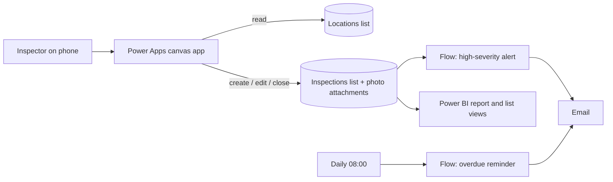
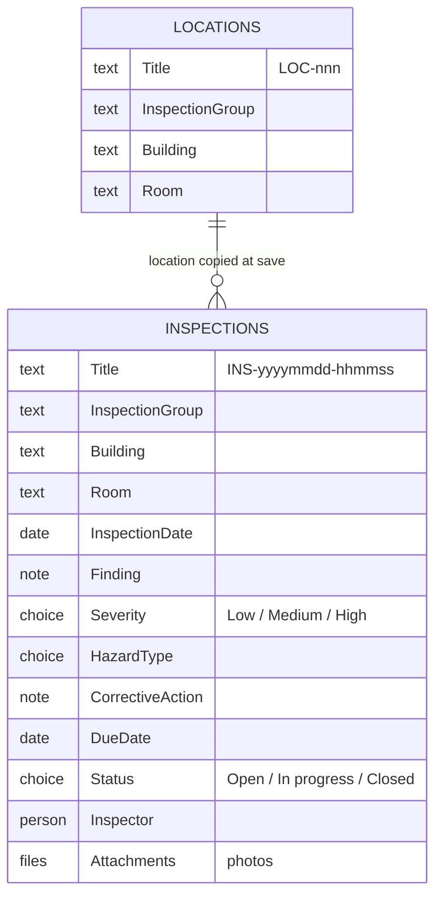

# Workplace Inspections — Power Apps + SharePoint + Power Automate

A low-code app for recording, tracking and reporting workplace safety inspections, built on Microsoft 365:
inspectors log findings on a phone, pick the location through cascading group → building → room
selections, attach photos, and the app enforces the rules a safety lead cares about. Flows email
high-severity findings and a daily overdue list; a Power BI report summarizes open findings by building.

> Built in Northeastern University's Microsoft 365 tenant with sample data (fictional buildings and rooms).

## What it does

| Need | How |
|---|---|
| Record an inspection | Power Apps canvas app (phone layout), Edit form over a SharePoint list |
| Group → building → room | Three cascading drop-downs driven by a `Locations` list |
| Photos and attachments | SharePoint attachments through the form's Attachments card |
| Validation | Location required, no future dates, High severity needs a corrective action and a due date within 7 days, due ≥ inspection date |
| Find and follow up | Search, status filter, overdue dates in red, one-tap *Close finding* |
| Alerts | Power Automate: email on every High finding; daily email of overdue findings |
| Reporting | Power BI quick report from the list; grouped and overdue list views; colour-coded severity column |
| Hand-over | Admin guide, inspector guide, test plan with results |

## Architecture

## Build it

1. [SharePoint lists](docs/01-sharepoint-lists.md) — import `data/*.csv`, set column types, formatting, views
2. [Canvas app](docs/02-power-app.md) — screens, Power Fx formulas, validation
3. [Power Automate](docs/03-power-automate.md) — alert and overdue flows
4. [Reporting](docs/04-reporting.md) — Power BI quick report, fallback views
5. [Test plan](docs/05-test-plan.md) · [Admin guide](docs/06-admin-guide.md) · [Inspector guide](docs/07-user-guide.md)

## Screenshots

| | |
|---|---|
| List with severity formatting | `screenshots/01-list.png` |
| Home screen | `screenshots/02-home.png` |
| Form with cascading pickers | `screenshots/03-form.png` |
| Validation | `screenshots/04-validation.png` |
| Flow runs | `screenshots/05-flow-alert.png`, `screenshots/06-flow-overdue.png` |
| Report | `screenshots/07-report.png` |
