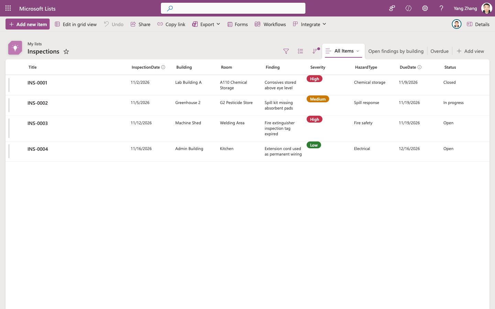
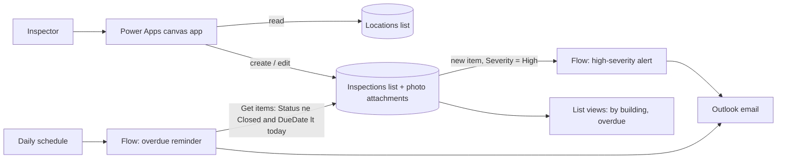
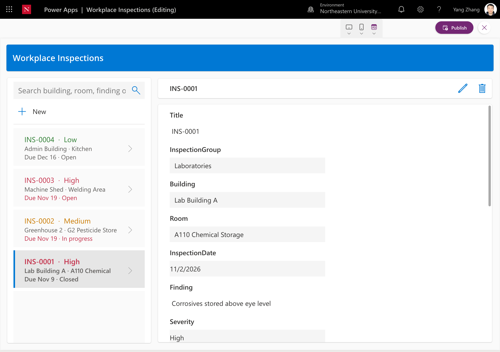
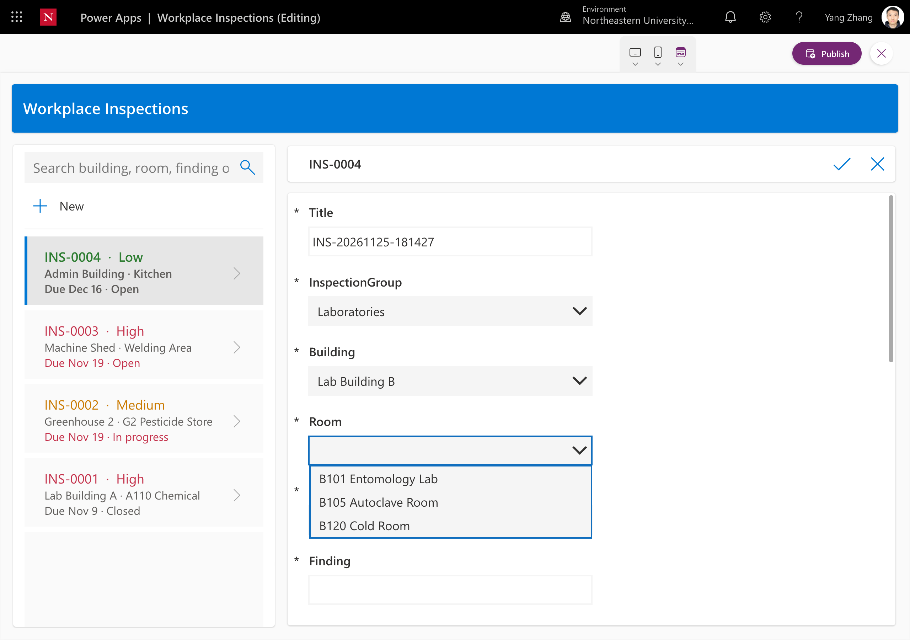
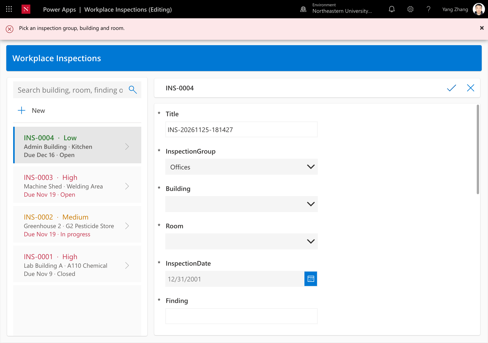
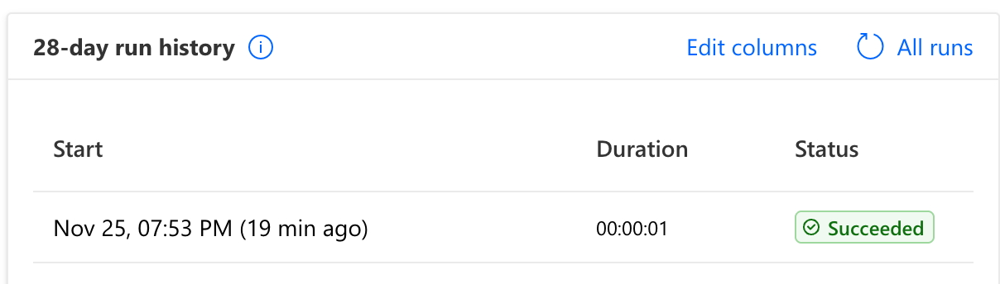
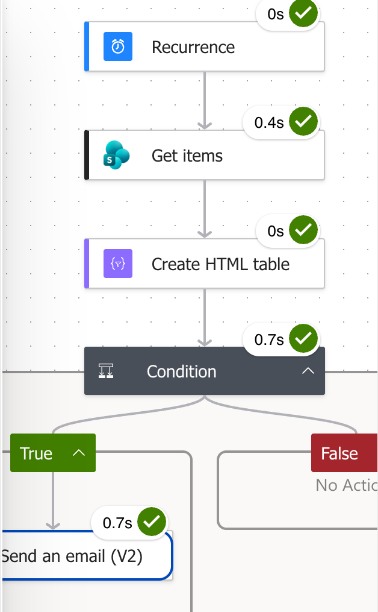

# Workplace Inspections — Power Apps + SharePoint + Power Automate

A low-code app for recording, tracking and following up workplace safety inspections, built in
Northeastern University's Microsoft 365 tenant. Inspectors log a finding, pick the location through
cascading **inspection group → building → room** selections, attach photos, and the app enforces the
rules a safety lead cares about. Two flows email every high-severity finding and a daily list of
overdue ones. Sample data only (fictional buildings and rooms).

## What it does

| Need | How it's built |
|---|---|
| Structured data | Two SharePoint lists: `Locations` (23 rooms) and `Inspections` (typed columns: dates, Choice, Person, multi-line, attachments) |
| Record an inspection | Power Apps canvas app generated from the list, then customized: list + detail/edit form |
| Group → building → room | Three cascading drop-downs over `Locations`; changing a level clears the levels below |
| Photos and attachments | SharePoint attachments through the form's Attachments card |
| Validation | Location required; date not in the future; High severity needs a corrective action and a due date within 7 days; due ≥ inspection date; SharePoint required fields surfaced on save failure |
| Defaults | Auto ID `INS-yyyymmdd-hhmmss`, inspection date = today, Status = Open |
| Follow-up | Newest first, severity colour in the list, overdue due dates in red, search by building/room/finding/status |
| Alerts | Power Automate: email on every **High** finding (trigger condition); daily email table of open items past due |
| Reporting | List views *Open findings by building* and *Overdue*; colour-coded Severity column (JSON formatting) |
| Hand-over | [Admin guide](docs/06-admin-guide.md), [inspector guide](docs/07-user-guide.md), [test plan with results](docs/05-test-plan.md) |

## Architecture

## Results

12 of 16 planned tests run and passed, including both flows end to end; 4 issues found and fixed
([details](docs/05-test-plan.md)).

| | |
|---|---|
| App: list with severity colours and overdue dates |  |
| Cascading pickers (Lab Building B → its 3 rooms) |  |
| Validation message |  |
| Alert flow: one run for the High test item, none for the Low one |  |
| Overdue flow: every step succeeded; table held exactly the two overdue items |  |

## Build it yourself

1. [SharePoint lists](docs/01-sharepoint-lists.md) · 2. [Canvas app](docs/02-power-app.md) · 3. [Power Automate](docs/03-power-automate.md) · 4. [Reporting](docs/04-reporting.md)

The guides describe a three-screen phone layout; the built app uses the list–detail layout Power Apps
generates from a list, with the same formulas (see *As built* in each guide).
